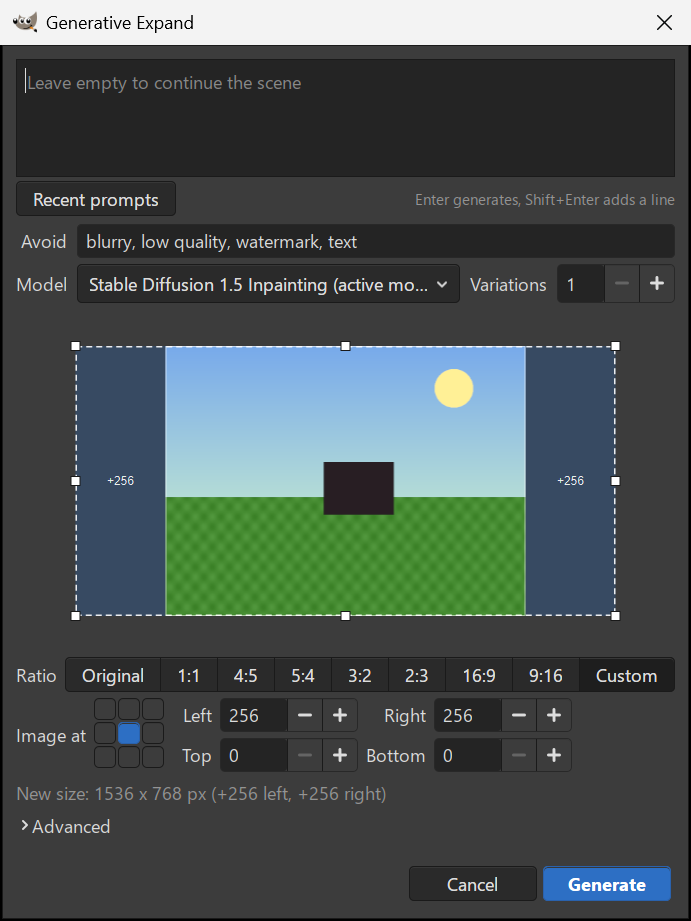

<div align="center">

# OpenFill

[](COPYING)     

*Generative fill for GIMP 3, running on your own graphics card. Turns out you never needed a monthly subscription and someone else's server to put a hot air balloon in your own photo.*


**Select an area, type what should be there, press Enter.**<br>
The result lands on a new layer with a soft mask. Nothing leaves your computer.

</div>


> [!IMPORTANT]
> **Beta.** This is 2.0.0-beta.1, the first release of OpenFill. It works end to end on Windows with GIMP 3.2.6 and an 8 GB laptop GPU, which is what I build and test on. The Linux and macOS install script exists but hasn't been run against a real GIMP there. Most of the rough edges are in what the models draw, not in the plug-in; [Status](#status) lists them.

OpenFill started as a GIMP 3 rewrite of [Stable Boy](https://github.com/thndrbrrr/gimp-stable-boy) by Torben Giesselmann.

## Why I made this

I moved to GIMP 3 as my Photoshop replacement, and the one thing I missed was Generative Fill. GIMP doesn't have one. People have been asking for it since 2023 ([GNOME/gimp#10086](https://gitlab.gnome.org/GNOME/gimp/-/issues/10086)). The plug-in that came closest, Stable Boy, was written for GIMP 2.10, wanted an AUTOMATIC1111 server open in a browser tab and a mask layer with a magic name, and GIMP 3 removed the plug-in API it was built on.

So OpenFill does it the Photoshop way. The selection is the mask, the result is a layer you can paint on or delete, and the AI backend (ComfyUI) starts hidden on the first request, stays warm while you work, and shuts down when GIMP closes. No terminal, no browser tab, no second app to babysit.

|  |  |
|---|---|
| **Fill with a prompt** | Select, type "a red door with brass handles", Enter. The fill lands on a new layer with a mask that fades at the edges. |
| **Remove object** | Select the thing, switch to Remove object, Enter. No prompt. It erases the selection and continues the background. |
| **Generative Expand** | Drag the canvas edges outward or pick a ratio, and it paints the new border. The prompt is optional. |
| **Text to Image** | A new layer or a new image from a prompt, sized to the selection if there is one. |

Everything is under `Filters > OpenFill`. Results always go on new layers, in one undo step, so your existing layers are never painted over.

## Keys

| Key | Action |
|---|---|
| `Enter` | Generate. |
| `Shift+Enter` | New line in the prompt. |
| `Escape` | Cancel. The image stays as it was. |
| `1` to `9` | Pick a variation in the picker. |

GIMP doesn't let a plug-in claim a shortcut of its own, but giving it one takes ten seconds: `Edit > Keyboard Shortcuts`, search "Generative Fill", click the shortcut column and press the keys. `Shift+Ctrl+G` is free in GIMP 3.2's defaults.

## The dialogs

|  |  |
|---|---|
|  |  |
| **Generative Fill.** Prompt, Recent prompts, what to avoid, the model and the number of variations are all on the first screen. Change amount and seed sit under Advanced. | **Remove object.** Same dialog, other tab. Nothing to type: it uses an installed removal model (LaMa or MAT) when there is one. |
|  |  |
| **Generative Expand.** Drag any edge of the thumbnail outward, or pick a ratio (1:1, 4:5, 3:2, 16:9 and the rest) and where the image sits on a 3x3 grid. It shows the new size as you drag. | **Models.** The download manager. What you have installed first, then Recommended for this PC, then the rest, from Hugging Face and Civitai. |
|  |  |
| **Progress.** Floats over your image without stealing focus: the step, time left, a live preview of the picture forming, and Cancel. | **Variations.** Ask for up to eight and click through them. The ones you don't keep stay hidden in a layer group in case you change your mind. |


## Models, and what fits your PC

OpenFill doesn't ship a model. The first time you run it, it says so and opens the download manager. Nothing downloads until you press Download, and the first model that finishes becomes the active one.

The Recommended for this PC list is built from your graphics memory, free disk space, and a live search of Hugging Face and Civitai, ranked by whether it fits first, then by how many people download it, then by how recent it is.

| Graphics memory | What you get |
|---|---|
| 2 GB and up | LaMa and MAT, the prompt-free removal models. Small (125 to 206 MB) and about 3 s per removal. |
| 4 GB and up | Stable Diffusion 1.5 inpainting. Fast, but weak at drawing what you asked for in flat or small areas. |
| 8 GB and up | DreamShaper 8, RealVisXL V5 and other SDXL models with the Fooocus inpaint patch, FLUX.1 Fill as a 4-bit GGUF (opt-in). Much better at following the prompt. |
| 12 GB and up | Qwen-Image-Edit as a GGUF. |
| 16 GB and up | FLUX.1 Fill at full size. |
| No NVIDIA GPU | Stable Diffusion 1.5 can run on the CPU, but a fill takes minutes, not seconds, and you have to raise the generation time limit in Settings. I have not tested AMD or Apple GPUs. |

A model that's too big for your machine is never recommended, because a model that has to spill out of graphics memory either crawls or crashes, and you'd find out after a 7 GB download. The search only takes single `.safetensors` or `.gguf` files with a known size, a published SHA-256 and a stated license, and never pickled `.ckpt` or `.bin` files, since those can run code when loaded. FLUX and Qwen are in the list but I haven't run them end to end on my machine. Every file, checksum and license is in [docs/models.md](docs/models.md).

How long it takes on my laptop (RTX 4070 Laptop, 8 GB, 20 steps, 2048 px photo):

| | Time |
|---|---|
| First request of the session (backend start) | 31 to 38 s, about 45 s to the first result |
| Fill, SD 1.5, 512 px selection | 8.4 to 8.7 s |
| Fill, SDXL + Fooocus, 512 px selection | 20.6 to 22.1 s |
| Remove object, LaMa or MAT | about 3 s |

Which model is used by default for each job comes from a judged benchmark of 33 cases per model (pass / notes / fail, strict rubric):

| Job | Default | Result |
|---|---|---|
| Fast fill | DreamShaper 8 Inpainting | 7 / 10 / 16, ahead of SD 1.5 inpainting (7 / 7 / 19) |
| Quality fill | RealVisXL V5 | 9 / 1 / 23, ahead of Juggernaut XL (5 / 4 / 24) and SDXL base (7 / 0 / 25) |
| Remove object | LaMa | 5 / 3 / 25, ahead of MAT (3 / 3 / 27) |
| Generative Expand | SD 1.5 inpainting, then DreamShaper 8 | best in 5 of 8 pairs; every model gets weaker beyond 25% per side |

FLUX.1 Fill is opt-in: it matches RealVisXL on object fills but takes about four times as long (median 112 s here), so it is never chosen automatically. The full method and raw numbers are in [docs/performance.md](docs/performance.md) and [docs/models.md](docs/models.md).

## Nothing leaves your computer

Generation runs in ComfyUI on your machine, listening on `127.0.0.1` only. A small supervisor starts it hidden, watches GIMP, and stops it after an idle timeout or when GIMP closes. The server is tied to the supervisor by Windows itself, so it can't be left running even after a crash. `Filters > OpenFill > Stop AI Backend` frees the graphics card right away.

The network comes into it twice: when the Models tab searches Hugging Face and Civitai (no account, no token, and you can turn it off), and when you press Download (a model, or ComfyUI itself when none is installed). Every file is checked against its size and SHA-256 before it's used. The gated FLUX files need a free Hugging Face token; it stays in your GIMP profile and only ever goes to Hugging Face. No accounts, no telemetry, nothing that phones home: the only outbound requests are the ones above. Details in [docs/security.md](docs/security.md).

## Install

On Windows: install GIMP 3.2 (or newer), unzip OpenFill, double-click `Install OpenFill.cmd`, open GIMP, run `Filters > OpenFill > Generative Fill...` and press **Download ComfyUI** when asked.

1. **GIMP 3.2.** Install it from [gimp.org](https://www.gimp.org/downloads/). You don't need to start it first.
2. **OpenFill.** Download the OpenFill zip from the [Releases page](https://github.com/beckettharriman/gimp-openfill/releases) and unzip it anywhere.
3. **Double-click `Install OpenFill.cmd`.** It copies the plug-in into your GIMP 3 profile and looks for a ComfyUI you may already have (the portable build, ComfyUI Desktop, Stability Matrix, Pinokio). Nothing is downloaded at this step and git is not needed.
4. **Open GIMP, open an image, select an area and run `Filters > OpenFill > Generative Fill...`.** If no ComfyUI was found, a notice says "ComfyUI is required". It checks your graphics card, free disk space and port 8188 first, then **Download ComfyUI** fetches the official Windows portable build (about 2 GB, about 7 GB unpacked) into `%LOCALAPPDATA%\OpenFill\ComfyUI`, checks it against a published SHA-256, unpacks it with Windows' own `tar.exe`, adds the inpaint nodes at a pinned commit and OpenCV, and remembers the folder. "I already have ComfyUI" lets you pick a folder instead. You can change the install folder in the notice.
5. **Download the starting models.** The model manager opens next: get LaMa (object removal, 0.2 GB) and DreamShaper 8 Inpainting (fill and expand, 2 GB). Then select some sky, type "hot air balloon", press Enter. The first request starts the backend, which takes about a minute; after that it's seconds.

The download needs an NVIDIA card. Without one the notice says so and offers the download only as "very slow" (the processor does the work); for an AMD card it points to ComfyUI's AMD instructions, after which you choose "I already have ComfyUI".

The same notice appears whenever you start Generative Fill, Remove or Expand and ComfyUI can't be found, instead of an error.

If something goes wrong, every error message ends with what to do next, and the same advice shows in the progress window. For a bug report, turn on Verbose log in Settings, do it again, and attach the log file. Never attach `config.json`, it may hold your token.

<details>
<summary><b>Manual and advanced install</b></summary>

You need GIMP 3.2 or newer and ComfyUI. OpenFill uses GIMP's own Python and needs no extra packages.

**ComfyUI.** Download the portable build from the [ComfyUI releases](https://github.com/Comfy-Org/ComfyUI/releases), extract it (Windows 10 and 11 can open `.7z` with `tar -xf`), and point OpenFill at the folder that holds `python_embeded` in `Filters > OpenFill > Generative Fill Settings`, or pass `-ComfyDir` to the installer. Any other ComfyUI checkout with a `venv` works too.

**Inpaint nodes.** Download the [comfyui-inpaint-nodes](https://github.com/Acly/comfyui-inpaint-nodes) archive of the commit pinned in `models/catalog.json` into `ComfyUI\custom_nodes\` (the plug-in's Models tab and `install.ps1 -Model` do this for you, from the GitHub zip, without git). For a cleaner seam on Generative Expand, also install OpenCV with ComfyUI's own Python:

```powershell
python_embeded\python.exe -s -m pip install opencv-python-headless
```

**The plug-in from a clone.** Close GIMP, then from the repository folder:

```powershell
powershell -ExecutionPolicy Bypass -File install.ps1
```

`install.ps1 -DetectComfy` lists the ComfyUI installs it can find. To build the release zip yourself: `python tools/make_release_zip.py`.

</details>

<details>
<summary><b>Linux, Flatpak and macOS</b></summary>

`install.sh` finds the GIMP 3 profile on Linux, Flatpak (`~/.var/app/org.gimp.GIMP/...`) and macOS:

```sh
sh install.sh
```

I've only run it against fake profiles on WSL Ubuntu and Git Bash, not a real Linux, Flatpak or macOS GIMP. If you try it, I'd like to hear how it went. The Download ComfyUI button is Windows-only.

</details>

<details>
<summary><b>Install options</b></summary>

| `install.ps1` | `install.sh` | Does |
|---|---|---|
| `-Link` | `--link` | Links the plug-in to your checkout instead of copying it, for development. |
| `-ProfileDir <dir>` | `--profile-dir <dir>` | Installs into a specific GIMP profile. `GIMP3_DIRECTORY` works too. |
| `-ComfyDir <dir>` | | Uses this ComfyUI instead of looking for one. |
| `-DetectComfy` | | Lists the ComfyUI installs found on this PC. |
| `-Uninstall` | `--uninstall` | Removes the plug-in. Keeps your settings and never touches models. |
| `-RemoveConfig` | `--remove-config` | With uninstall, also deletes the settings folder (it holds the Hugging Face token, if any). |
| `-ListModels`, `-Model <id>` | | Lists or downloads a model without opening GIMP, with resume and checksum. |

The scripts install the plug-in as `gimp-openfill/` and keep settings in `<GIMP profile>/openfill/config.json`. Settings from an older `stable-boy` folder are copied over on the first run.

</details>

## Status

Working on Windows with GIMP 3.2.6: Fill, Remove object, Expand, Text to Image, the download manager with live search, the progress window, variations, the backend starting and stopping itself. That's the machine I use. 25 failure scenarios (no backend, corrupt settings, port in use, ComfyUI killed mid-job, GIMP killed mid-job, no network, cancel at every stage) pass in a real GIMP, and the unit tests run on any Python 3.10 or newer.

What the models still get wrong:

- **SD 1.5 often ignores the prompt** on flat areas and small selections and just continues the background. Switch to an SDXL model in the dialog.
- **Remove object struggles with big holes.** LaMa smears, MAT invents things (fake text, shapes that weren't there). Both are fine on small objects. LaMa is the default and works over large holes in overlapping windows, which helps, but very large holes are still weak.
- **Generative Expand gets weaker beyond 25% per side.** The editor warns you; expand in rounds (the plug-in also splits large expansions itself). SD 1.5 inpainting continues a scene best, so OpenFill offers it when you pick another model, and respects your choice if you decline.
- Fine textures like fabric come back softer in large fills.

Not tested yet: Linux and macOS GIMP, FLUX and Qwen end to end, and the AUTOMATIC1111 backend option. Next up: ControlNet and reference images, LoRA selection, and those tests.

The changes are in [CHANGELOG.md](CHANGELOG.md), and [CONTRIBUTING.md](CONTRIBUTING.md) covers the tests and running GIMP against a throwaway profile.

## Where it came from

OpenFill began as a port of [Stable Boy](https://github.com/thndrbrrr/gimp-stable-boy), Torben Giesselmann's GIMP 2.10 plug-in for the AUTOMATIC1111 WebUI. GIMP 3 threw out the plug-in API it was written against, so not much of the code survived, but the idea and the license did, and his name stays on it. The backend is [ComfyUI](https://github.com/comfyanonymous/ComfyUI). Acly's [comfyui-inpaint-nodes](https://github.com/Acly/comfyui-inpaint-nodes) do the inpainting, and his [krita-ai-diffusion](https://github.com/Acly/krita-ai-diffusion) was the reference for how to build the graphs and manage the server. The model authors and their licenses are listed in [docs/models.md](docs/models.md).

Open, as in GPL and on your own machine. Fill, as in the thing everyone else rents you by the month.

## License

[GPL-3.0-or-later](COPYING) © 2022 Torben Giesselmann, © 2026 Beckett Harriman.
