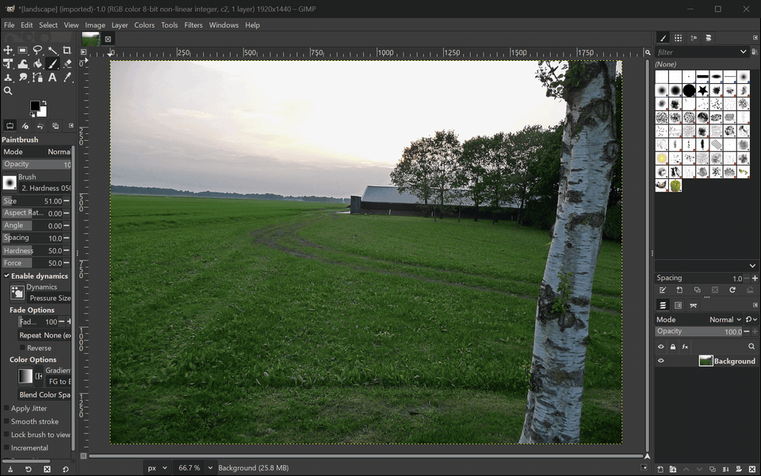
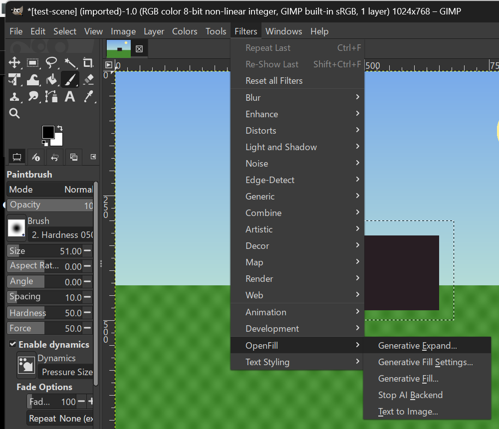
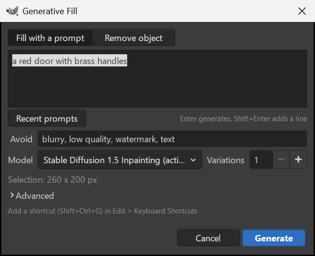
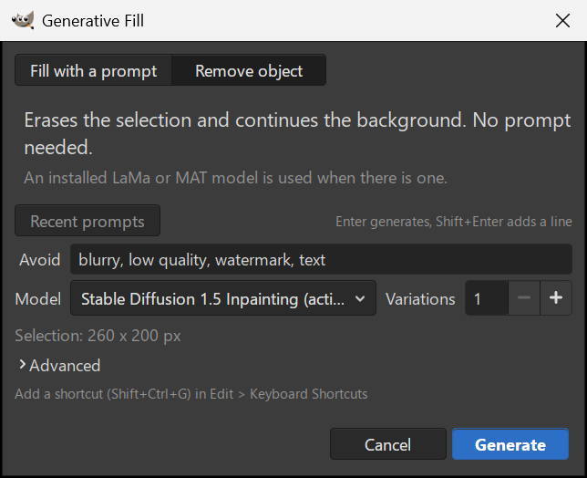
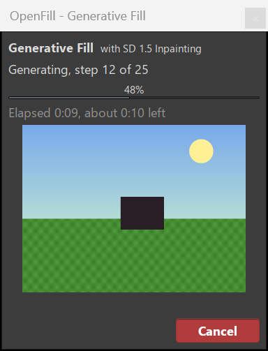
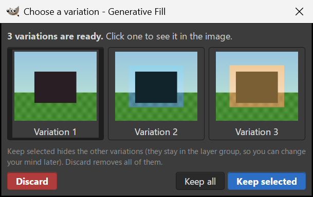
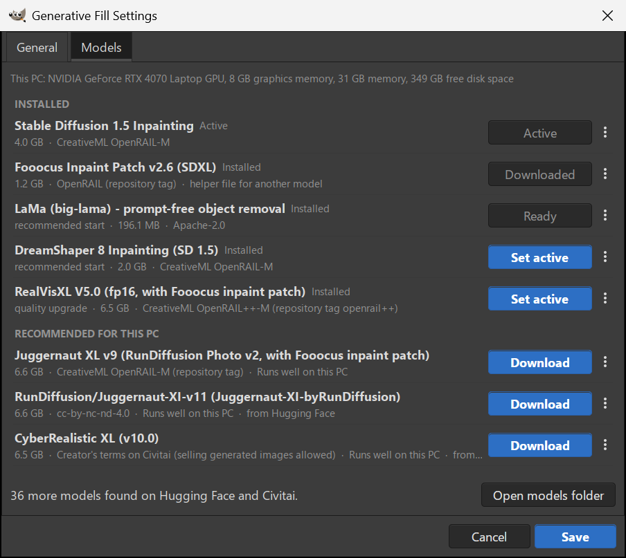
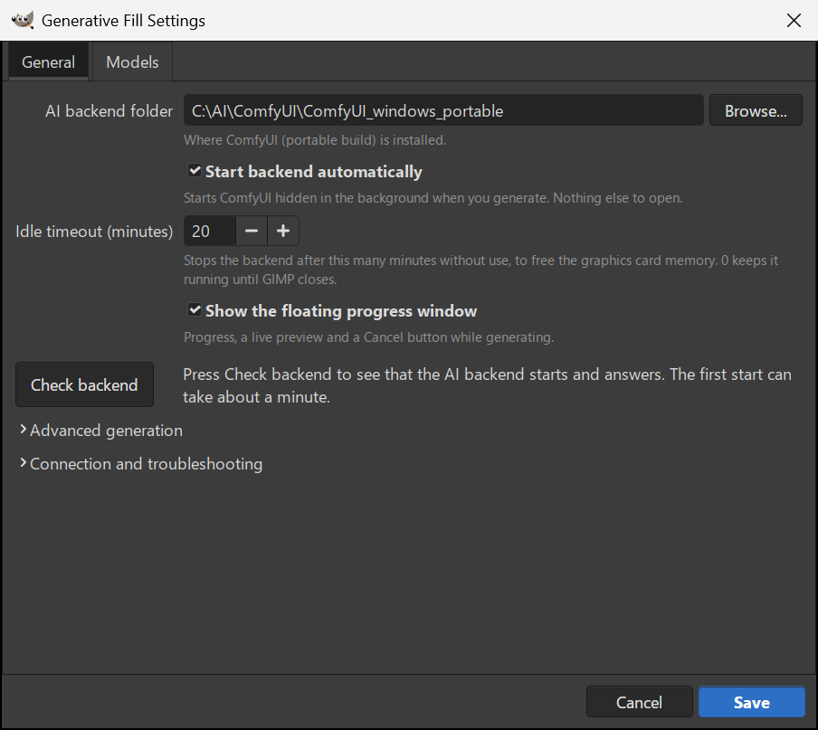

# OpenFill - Generative Fill for GIMP 3

Select an area in GIMP, type what should be there, press Generate, and the
result appears as a new layer with a soft layer mask in the same image.
OpenFill brings a Photoshop-style **Generative Fill**, **Remove object**,
**Generative Expand** and **Text to Image** to GIMP 3, running local diffusion
models through a ComfyUI backend that the plug-in installs models into,
starts, keeps warm and shuts down by itself. No terminal, no browser tab, no
second application, and nothing leaves the machine.

Version 2.0.0-beta.1. OpenFill is a GIMP 3 rewrite of
[Stable Boy](https://github.com/thndrbrrr/gimp-stable-boy) by Torben
Giesselmann (thndrbrrr), the GIMP 2.10 plug-in for the AUTOMATIC1111 WebUI.
It keeps the name, the license and the idea; the code, the backend handling
and the UX are new.



*Recorded from a real run with Juggernaut XL on an RTX 4070 Laptop (24 s, idle stretches trimmed). The dialog itself is shown below.*

## What it does

Five entries under `Filters > OpenFill` (GIMP sorts them alphabetically):



| Entry | What happens |
|---|---|
| **Generative Fill...** | Fills the selection from a prompt. The result is a new layer with a layer mask; 1 to 8 variations go into a layer group. **Change amount** below 1.0 keeps part of what is there (image-to-image). |
| Generative Fill, **Remove object** | Erases the selection and continues the background, no prompt needed. An installed LaMa or MAT removal model is used automatically; otherwise the chosen model with a background prompt. |
| **Generative Expand...** | Grows the canvas by the margins you enter (or **Wider**, **Taller**, **All sides**) and paints the new border. The image is untouched if generation fails. |
| **Text to Image...** | Generates into a new layer (sized to the selection when there is one) or a new image. |
| **Generative Fill Settings...** | Backend folder, autostart, idle timeout, progress window, **Check backend**, and the **Models** tab. |
| **Stop AI Backend** | Shuts the managed ComfyUI process down to free the GPU. It starts again on the next request. |

| Fill with a prompt | Remove object |
|---|---|
|  |  |

While it runs, a small always-on-top window shows the step, elapsed and
remaining time, a live preview of the picture forming, and a **Cancel** button
that leaves the image unchanged. With more than one variation, a picker opens
afterwards:

| Progress window | Variations picker |
|---|---|
|  |  |

The screenshots were captured in GIMP 3.2.6 on Windows by
`tests/gimp_batch_ui_screenshots.py`; the progress window and the picker are
driven by test hooks there (scripted steps, tinted copies as stand-in
variations), not by a real generation. More screens: `docs/screenshots/`.

## Why this exists

GIMP has no built-in generative fill. The request is
[GNOME/gimp#10086](https://gitlab.gnome.org/GNOME/gimp/-/issues/10086), open
since 2023: "as easy as Photoshop", with the plug-in handling the backend for
the user. It cites the original Stable Boy, which only ran on GIMP 2.10
(Python 2, `gimpfu`) and expected an AUTOMATIC1111 server in a browser and a
mask layer with a magic name. GIMP 3 removed that plug-in API entirely.

OpenFill aims at the Photoshop flow: the selection is the mask, the result
is a non-destructive masked layer, and the backend lifecycle needs zero
terminal work: models download from a dialog, the server starts hidden on the
first request and stops when GIMP closes or after an idle timeout.

## How it works

A GIMP Python plug-in is a short-lived process: GIMP starts it for one
procedure call and it exits when the call returns. It cannot keep a server
warm or notice that GIMP closed. So the first request launches a small
**supervisor** (`openfill/supervisor.py`, GIMP's `pythonw`, no console)
that starts ComfyUI hidden, ties it to a Windows **Job Object** with
kill-on-close (the server can never outlive the supervisor, even after a
crash), watches the GIMP process, and applies the idle timeout.
`server-state.json` in the profile is the only contract between plug-in runs
and the supervisor. The supervisor also runs model downloads and custom-node
installs so they continue after the dialog closes.

Per request the plug-in:

1. crops a **context region** around the selection (a margin proportional to
   the selection, wider for removal), flattened over its mean colour where it
   is transparent;
2. scales it to the model's **working size** (for example 768 px for SD 1.5,
   1024 px for SDXL; tiny selections are upscaled so the model works at full
   resolution) and snaps it to the latent multiple;
3. sends the crop and a **mask** grown and feathered in proportion to the
   selection as PNGs, builds a ComfyUI API **graph** in code
   (`openfill/workflow.py`: SD 1.5 inpainting, SDXL + Fooocus inpaint
   patch, FLUX Fill, Qwen-Image-Edit, LaMa/MAT removal) and queues it;
4. streams progress and preview frames over ComfyUI's websocket;
5. scales the result back and inserts it as a layer whose mask is opaque over
   the selection and fades outward, in one undo group.

Everything in `openfill/` except `gimp_io.py` and the GTK dialog modules is
plain Python with no GIMP dependency, which is what makes it unit-testable.
Details, the graphs, and what was learned from krita-ai-diffusion and other
GIMP plug-ins: [docs/design.md](docs/design.md).

## Requirements

- GIMP 3.2 or newer. Tested with GIMP 3.2.6 on Windows 11. The plug-in uses
  GIMP's bundled Python and needs no extra Python packages.
- ComfyUI (tested with 0.39.0, Windows portable NVIDIA build) with
  [comfyui-inpaint-nodes](https://github.com/Acly/comfyui-inpaint-nodes).
- An NVIDIA GPU; 8 GB of VRAM covers SD 1.5, SDXL and the removal models.
  CPU-only works for SD 1.5 but is slow.
- Disk: 4.3 GB for SD 1.5, 12.5 GB with the SDXL tier
  ([docs/models.md](docs/models.md)).

End-to-end generation has been tested on Windows only. `install.sh` was
exercised on WSL Ubuntu and Git Bash with fake profiles (transcripts in
`docs/evidence/overnight-2026-10-09/rob-fresh-install/`), not with a real
Linux, Flatpak or macOS GIMP.

## Install

1. **ComfyUI.** Download the portable build from the
   [Comfy-Org/ComfyUI releases](https://github.com/Comfy-Org/ComfyUI/releases)
   and extract it, for example to `C:\AI\ComfyUI` (so that
   `C:\AI\ComfyUI\ComfyUI_windows_portable\ComfyUI\main.py` exists). Any other
   ComfyUI checkout works; choose its folder in Settings.
2. **Inpaint nodes.** `git clone https://github.com/Acly/comfyui-inpaint-nodes`
   into `ComfyUI\custom_nodes\`. For a smoother Generative Expand seam also
   install `opencv-python-headless` with ComfyUI's own Python
   (`python_embeded\python.exe -s -m pip install opencv-python-headless`).
3. **Plug-in.** Close GIMP, then from this repository:

   ```powershell
   # Windows
   powershell -ExecutionPolicy Bypass -File install.ps1
   ```
   ```sh
   # Linux, Flatpak (~/.var/app/org.gimp.GIMP/...), macOS
   sh install.sh
   ```

   Both copy `gimp-openfill/` into the newest GIMP 3.x profile and write a
   default `openfill/config.json`. Options: `-Link` / `--link` (junction or
   symlink to the checkout, for development), `-ProfileDir` / `--profile-dir`
   (a specific profile; `GIMP3_DIRECTORY` is honoured too), `-Uninstall` /
   `--uninstall`, plus `-RemoveConfig` / `--remove-config` to delete the
   settings folder as well (it holds the Hugging Face token, if any).
4. **Models.** Start GIMP, open `Filters > OpenFill > Generative Fill Settings... >
   Models`, press **Download** on a model and then **Set active**. Without
   GIMP: `install.ps1 -ListModels` and `install.ps1 -Model sd15-inpainting`
   (downloads with resume and verifies the sha256).

The first request starts ComfyUI, which takes about a minute; later requests
reuse the running server.

## Usage

1. Open an image and select an area with any selection tool.
2. `Filters > OpenFill > Generative Fill...`. Type what should appear and press
   Enter (or **Generate**). The last prompt is pre-filled and selected, so
   typing replaces it; **Recent prompts** holds the last 20.
3. To erase something, switch to **Remove object** and press Generate. Select
   the whole object with a little margin.
4. The result is a layer named `Generative Fill: <prompt>` with a layer mask
   above the active layer. Paint on the mask to refine the blend; delete the
   layer to discard it.

**Advanced** (collapsed): Model (the active model first, then downloaded
ones, then the rest), Avoid (negative prompt), Variations, Change amount, Seed
(Random or a fixed number to repeat a result).

Keys: Enter generates, Shift+Enter starts a new line, Escape cancels. In the
variations picker, 1 to 9 pick a variation and Enter or Escape keep it.

**Give Generative Fill a shortcut.** GIMP does not let a plug-in claim a key,
but it takes a few seconds:

1. `Edit > Keyboard Shortcuts`.
2. Type "Generative Fill" in the search box.
3. Click the Shortcut column of "Generative Fill..." and press the keys, for
   example **Shift+Ctrl+G** (unused in GIMP 3.2's defaults). If GIMP reports
   a conflict, pick another combination.
4. Close the dialog; the shortcut is saved in your profile.

The same works for Generative Expand, Text to Image and the Settings.

Scripts and batch mode can call the procedures through the PDB with
`RunMode.NONINTERACTIVE`; `tests/gimp_batch_fill.py` is a complete example.

## Models

The Models tab lists every entry of `models/catalog.json`, downloaded ones
first. One button per row follows the state (**Download**, **Downloading N% -
Cancel**, **Resume download**, **Set active**, **Active**, **Install nodes**);
the menu next to it opens the model page and license or deletes the files.



| Catalog id | Model | Tier | Download | Min. VRAM | License |
|---|---|---|---|---|---|
| `sd15-inpainting` | Stable Diffusion 1.5 Inpainting (default) | fast | 4.3 GB | 4 GB | CreativeML OpenRAIL-M |
| `sdxl-base` | SDXL 1.0 Base + Fooocus inpaint patch | quality | 6.9 GB + patch | 8 GB | CreativeML OpenRAIL++-M |
| `fooocus-inpaint-patch` | Fooocus inpaint head + v2.6 patch (helper for SDXL entries) | quality | 1.3 GB | - | OpenRAIL (repository tag) |
| `juggernaut-xl-v9` | Juggernaut XL v9 + Fooocus patch | quality | 7.1 GB + patch | 8 GB | CreativeML OpenRAIL-M (repository tag) |
| `flux1-fill-dev-gguf-q4` | FLUX.1 Fill [dev] GGUF Q4_0 + encoders + VAE | quality | 10.8 GB | 8 GB | FLUX.1 [dev] Non-Commercial; gated VAE |
| `flux1-fill-dev` | FLUX.1 Fill [dev] safetensors | quality | 29.3 GB | 16 GB | FLUX.1 [dev] Non-Commercial; gated |
| `qwen-image-edit-2511-gguf-q4` | Qwen-Image-Edit-2511 GGUF Q4_K_M | edit | 22.9 GB | 12 GB | Apache-2.0 |
| `lama-big` | LaMa big-lama, prompt-free removal | removal | 206 MB | 2 GB | Apache-2.0 |
| `mat-places512` | MAT Places512 fp16, prompt-free removal | removal | 125 MB | 2 GB | CC BY-NC 4.0 |

Sizes are in decimal GB from the catalog. Every file has a size and a
sha256 in the catalog and is verified before it is used. FLUX and Qwen need
the ComfyUI-GGUF node pack, which the tab installs at a pinned commit after
asking. Gated FLUX files need the license accepted on Hugging Face and a read
token; the token field appears in the Models tab only when it matters and is
stored only in the profile's `config.json`. Exact files, checksums, sources
and the VRAM budget: [docs/models.md](docs/models.md). FLUX and Qwen are in
the catalog but were not run end to end on the development machine.

## Settings



The General tab holds only what a user needs: **AI backend folder** (with
**Browse...**), **Start backend automatically**, **Idle timeout (minutes)**
(0 keeps the backend until GIMP closes), **Show the floating progress
window**, and **Check backend**, which starts the backend if needed and
reports for example "Backend OK: 4 models, inpaint nodes installed." Two
collapsed sections hold the rest:

- **Advanced generation**: Steps, Prompt strictness (CFG), Sampler,
  Scheduler, Repaint margin and Edge softness (as a percentage of the
  selection, with pixel limits), Hide old content before generating, working
  sizes, Text to Image default size.
- **Connection and troubleshooting**: backend (ComfyUI, or an AUTOMATIC1111
  WebUI you start yourself with `--api`; that path is untested here),
  addresses, time limits, Extra ComfyUI options (for example `--lowvram`),
  files used by older scripts, Verbose log.

Everything is stored in `<GIMP profile>/openfill/config.json`; an
unreadable file is moved aside and replaced by defaults. Every key with its
default: [docs/design.md](docs/design.md#settings). Logs:
`openfill.log` (plug-in and supervisor) and `comfyui.log` in the same
folder.

## Performance

Measured timings (cold start, warm fills per model at 512, 1024 and 2048 px
selections, memory over 20 fills, UI responsiveness) and the optimizations the
plug-in already makes are in [docs/performance.md](docs/performance.md).

| Measurement (RTX 4070 Laptop 8 GB, 20 steps, 2048 px photo) | Value |
|---|---|
| Backend cold start (ComfyUI launch to ready) | 31 to 38 s (about 45 s to the first result) |
| Warm fill, SD 1.5, 512 px selection | 8.4 to 8.7 s |
| Warm fill, SDXL + Fooocus, 512 px selection | 20.6 to 22.1 s |
| Remove object, MAT, 512 px selection | 2.9 to 3.3 s |

## Troubleshooting

Every error message names a next step, and the same advice appears in the
progress window. The most common ones:

| Symptom or message | What to do |
|---|---|
| "Nothing is selected." | Select the area first. To regenerate the whole image use `Select > All`. |
| "ComfyUI was not found at ..." | Settings > General > **AI backend folder** > **Browse...**; the folder must contain `ComfyUI\main.py` (portable) or `main.py` (checkout). |
| "... auto-start is disabled" | Turn on **Start backend automatically**, or start ComfyUI yourself. |
| "ComfyUI did not start at ... (gave up after N s)" | Try again (the first start can take a few minutes). Check the ComfyUI folder and Extra ComfyUI options; the message quotes the last lines of `comfyui.log`. |
| "Port 8188 is used by another program (it is not ComfyUI)." | Close that program, or set a free port in the ComfyUI URL in Settings (for example `http://127.0.0.1:8190`). |
| "ComfyUI stopped while it was generating (it crashed or was closed), so the image was not changed." | Run the command again to restart it; if it keeps happening, read `comfyui.log` in the `openfill` folder of your GIMP profile. |
| "Your settings file could not be read and was moved aside to '...config.json.corrupt-...'; defaults are in use." | Open Generative Fill Settings and set the backend folder and options again. The old file is kept next to the new one. |
| "Generation was cancelled." / "The generation was stopped in ComfyUI ..." | Nothing in the image was changed. Run the command again. The second form means Cancel or Interrupt was used in ComfyUI itself. |
| "Could not reach huggingface.co: ..." (model download) | Check the internet connection and any proxy or firewall, then press **Download** again; the part already downloaded resumes. |
| "not enough disk space on ...: the download needs ..." | Free up space on that drive, then press **Download** again. |
| "... is not downloaded yet" / model missing | Settings > Models: **Download**, then **Set active**. |
| "The GPU ran out of memory" | Smaller selection, one variation, SD 1.5, or `--lowvram` in Extra ComfyUI options. |
| "The request timed out" | Smaller selection or fewer variations, or raise **Generation time limit** in Connection and troubleshooting (0 estimates it per request). |
| "Convert it with Image > Mode > RGB" | Indexed images are not supported; convert to RGB first. |
| The fill shows sky or background instead of the prompt | Known SD 1.5 limitation on flat or small areas (see below). Use an SDXL model (**Advanced** > Model), a more specific prompt, or another seed. |
| Visible seam or pale band | Keep **Hide old content before generating** on, make sure comfyui-inpaint-nodes is installed, raise Edge softness. |
| Menu entries missing | Check `pluginrc` in the profile for `python-fu-openfill-generative-fill`; the folder must be `plug-ins/gimp-openfill/gimp-openfill.py`. Restart GIMP. |
| Backend still running after GIMP closed | Should not happen (the supervisor watches GIMP). Use **Stop AI Backend**, and report it with `openfill.log`. |

For a bug report, turn on **Verbose log**, reproduce, and attach
`openfill.log`. Never attach `config.json`: it may hold your token.

### Known limitations

- **SD 1.5 (Fast tier) prompt adherence.** On flat or featureless regions and
  small selections it often continues the background instead of drawing the
  prompt. An ablation on the exact crop the plug-in sent found no graph step
  responsible (`docs/evidence/overnight-2026-10-09/sd15-prompt-ablation/`).
  Use the Quality tier (an SDXL model under **Advanced** > Model).
- The Quality tier can return a flat tinted area on some structured
  backgrounds (a bare wall next to a facade) instead of the prompt.
- Generative Expand on all sides at once fails on the Quality tier (a blurred
  frame); expand one side at a time, or use SD 1.5.
- Fine textures such as fabric come back softer in large fills and
  expansions, which are generated below 1:1 resolution.
- **Remove object** with MAT cannot rebuild structured backgrounds (window
  frames behind an air conditioner).
- Out-of-VRAM and disk-full handling is covered by unit tests only; neither
  could be provoked on the 8 GB development machine.
- Generative Expand's Discard removes the new layers but keeps the larger
  canvas; `Edit > Undo` twice restores it.
- AUTOMATIC1111, FLUX, Qwen and the Linux/macOS installs are implemented but
  not verified end to end.

## Testing and evidence

- **Unit tests**: `python -m unittest discover -t . -s tests -v` (standard
  library only, no GIMP). They cover geometry, graph building, the ComfyUI
  client, websocket framing, PNG encoding, the catalog, resumable verified
  downloads, the supervisor, config recovery and the dialog text logic.
- **Lint**: `uv tool run ruff@0.14.0 check .` and `format --check .`,
  configured in `pyproject.toml`.
- **CI**: `.github/workflows/ci.yml` runs ruff and the unit tests on Python
  3.10 and 3.12.
- **GIMP batch harness**: `tests/gimp_batch_*.py` run inside a real GIMP
  through the `python-fu-eval` batch interpreter and drive the registered
  procedures non-interactively: fills, the case matrix, small selections,
  model management, robustness (missing backend, corrupt config, busy port),
  the progress window and the UI screenshots. Always with `--new-instance`.
- **Isolated profile**: setting `GIMP3_DIRECTORY` to a scratch folder and
  running `install.ps1 -Link` gives GIMP a throw-away profile, so a test run
  never touches your real settings
  ([CONTRIBUTING.md](CONTRIBUTING.md#isolated-profile-gimp3_directory)).
- **Evidence**: `docs/evidence/<run>/<case-id>/` holds the exact command,
  `report.json`, downscaled before/after images and the plug-in log lines;
  the index of the 2026-10-09 run is
  [docs/evidence/overnight-2026-10-09/README.md](docs/evidence/overnight-2026-10-09/README.md).

**Synthetic matrix.** 64 cases (selections, image modes and sizes, every
mode and tier, prompts) were scored visually in the deliberately blunt
[quality ledger](docs/evidence/overnight-2026-10-09/quality-ledger.md): **11 PASS, 33 PASS-WITH-NOTES,
20 FAIL**. 14 of the FAILs are model behaviour (SD 1.5 ignoring the prompt on
flat sky or a 20 px selection, where the Quality tier draws it); the other 6
are plug-in-side weaknesses still open (washed-out fine texture on offset or
grouped layers, a too-short working crop on a 16:1 strip, `sel-feathered`,
`sel-edge-bottom`). An A/B of pre-fill, colour matching and working size is
recorded in the ledger's last section.

**Real photos.** 28 remove, replace and extend cases on six Wikimedia
Commons photographs (face, fabric, landscape, architecture, text, product)
score **8 PASS, 10 PASS-WITH-NOTES, 10 FAIL** after the fixes they prompted
(MAT working size, Quality-tier pre-fill, expand context band, PNG upload
padding; A/B crops in [photo-ab](docs/evidence/overnight-2026-10-09/photo-ab/README.md)). Sources and
selections: [photos-README.md](docs/evidence/overnight-2026-10-09/photos-README.md). The photos are CC0
(five) and public domain (one NASA portrait); they are not stored in the
repository.

**Robustness**, verified end to end in GIMP 3.2.6 (`rob-*` folders, all
PASS): backend folder missing, `config.json` missing or corrupt, autostart
off with the backend down, port in use (an HTTP server, a silent listener,
and offline), extra server options starting with a dash, ComfyUI killed
mid-job, an external ComfyUI, a missing model (with and without a running
server), two GIMP instances at once and the first one exiting mid-job,
Cancel while starting, uploading, sampling and downloading, Interrupt from
ComfyUI itself, GIMP killed mid-generation, the idle timeout, a corrupt
`.part` file and downloads without network. Out-of-VRAM could not be
provoked on 8 GB and disk-full is unit-tested only.

## Security

The plug-in runs a local server and downloads models and node packs, so it
validates what it fetches: https only, catalog sizes and sha256 checked
before an atomic rename, custom nodes only at the pinned full commit, task
files re-validated against the catalog, the Hugging Face token sent only to
Hugging Face hosts over https and redacted from logs, subprocesses started
without a shell, and no code executed from the network beyond the pinned
node packs and model files the catalog lists. Details:
[docs/security.md](docs/security.md). Report problems privately as described
in [SECURITY.md](SECURITY.md).

## Roadmap

- ControlNet and IP-Adapter reference images
- LoRA selection
- Smoke tests against real Linux, Flatpak and macOS GIMP builds
- LaMa and FLUX tiers verified end to end (both are in the catalog; only MAT
  and the SD 1.5 / SDXL models were run on the development machine), as the
  longer-term answer to the SD 1.5 prompt-adherence limitation

## Credits

OpenFill is based on Stable Boy by Torben Giesselmann (GPL-3.0),
https://github.com/thndrbrrr/gimp-stable-boy.

- **Torben Giesselmann (thndrbrrr)** wrote the original Stable Boy for GIMP
  2.10 and the AUTOMATIC1111 integration this project started from.
- [ComfyUI](https://github.com/comfyanonymous/ComfyUI) by comfyanonymous and
  Comfy-Org is the backend.
- [comfyui-inpaint-nodes](https://github.com/Acly/comfyui-inpaint-nodes) and
  [krita-ai-diffusion](https://github.com/Acly/krita-ai-diffusion) by Acly
  provided the inpaint nodes and the reference for the graph design and
  server management.
- Model authors: Runway and CompVis (SD 1.5 inpainting), Stability AI (SDXL),
  lllyasviel (Fooocus inpaint), RunDiffusion (Juggernaut XL), Black Forest
  Labs (FLUX.1), the Qwen team, advimman (LaMa), fenglinglwb (MAT), and the
  quantizations by YarvixPA, city96 and unsloth. Licenses in
  [docs/models.md](docs/models.md).

## License

GPL-3.0-or-later. See [COPYING](COPYING).
Copyright (C) 2022 Torben Giesselmann, (C) 2026 Beckett Harriman.
